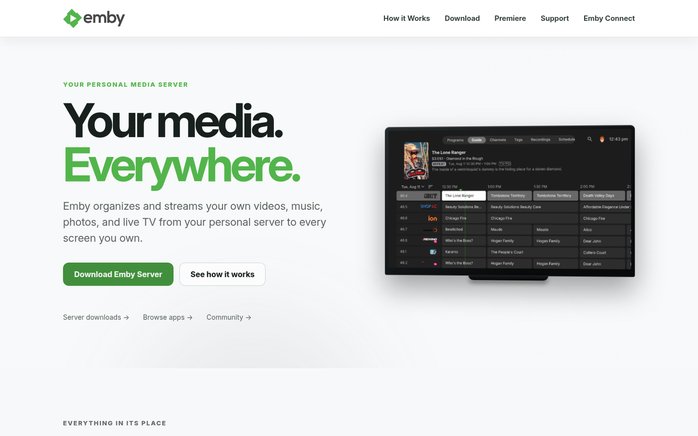
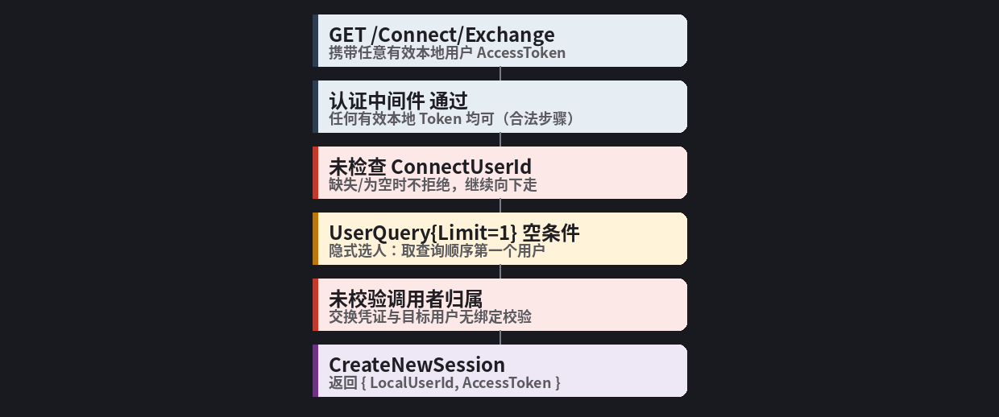
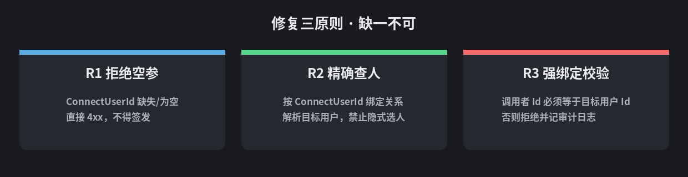
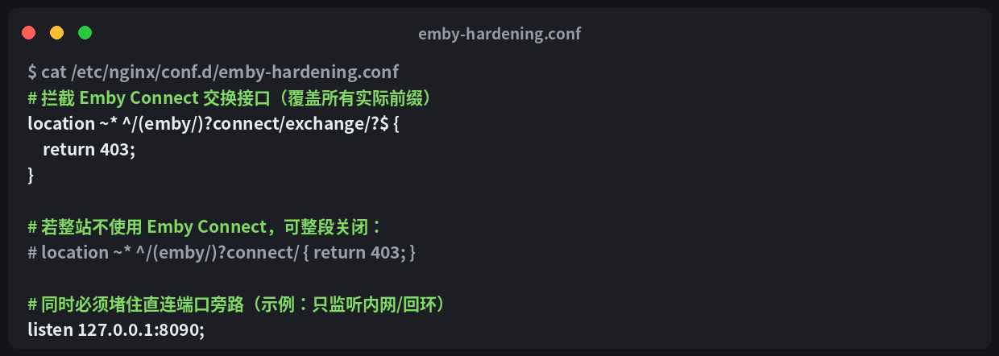
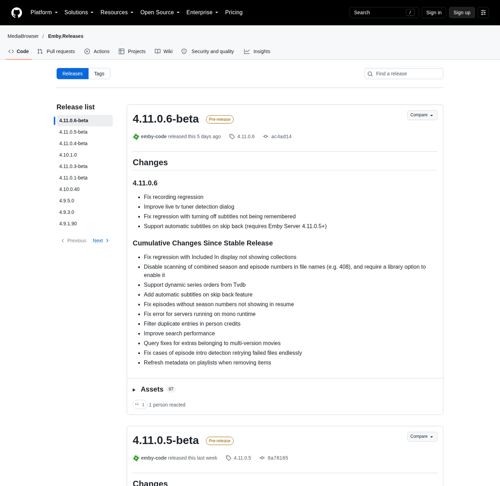

> **一句话预告**：这不是一个"被打了"的故事，而是一个"门没锁"的故事。Emby Server 的 `/Connect/Exchange` 接口在 `ConnectUserId` 为空时不拒绝请求、不校验目标归属，任何一个持有普通账号 AccessToken 的用户，都可能通过这个接口换出**别人**（往往是初始管理员）的会话令牌。
>
> 影响版本：**Emby Server 4.1.1.0 – 4.11.0.6**，暂无公开 CVE 编号。本文仅作获得授权环境下的漏洞分析与防御加固参考，**不包含任何利用脚本、请求载荷或复现步骤**。



---

## 目录

1. [背景：这个接口是干什么的](#一背景这个接口是干什么的)
2. [三段式根因：门是在哪一步没锁上的](#二三段式根因门是在哪一步没锁上的)
3. [为什么被选中的往往正好是管理员](#三为什么被选中的往往正好是管理员)
4. [危害评估：低门槛 + 高影响 + 弱可观测](#四危害评估低门槛--高影响--弱可观测)
5. [修复方案：代码级根治](#五修复方案代码级根治)
6. [来不及改代码？先上 Nginx 应急阻断](#六来不及改代码先上-nginx-应急阻断)
7. [回归验收清单](#七回归验收清单)
8. [如何排查自己是否已被利用](#八如何排查自己是否已被利用)
9. [给所有自托管开发者的一课](#九给所有自托管开发者的一课)

---

## 一、背景：这个接口是干什么的

Emby 的 **Emby Connect** 功能允许把 Emby Connect 云端账号与本地服务器账号绑定。绑定流程中，客户端会请求：

```
GET /Connect/Exchange
```

设计意图上，这个接口有三条隐含约束：

1. **发起者必须已认证**（携带有效本地 AccessToken）；
2. **换取的对象必须由 `ConnectUserId` 明确指定**——即"你要换的是哪个 Connect 账号绑定的本地用户"；
3. **换出来的会话必须属于被明确授权的目标用户**——即"你只能换你自己的票"。

问题在于：实际实现中，**只有第 1 条被真正执行了**。第 2、3 条形同虚设。

---

## 二、三段式根因：门是在哪一步没锁上的

把整个调用链摊开看，缺陷一目了然：



| 编号 | 根因 | 说明 |
|---|---|---|
| **R1** | 缺失参数未拒绝 | `ConnectUserId` 为空时不返回错误，继续走后续逻辑，形成触发入口 |
| **R2** | 目标用户隐式选择 | 依赖 `Limit=1` + `FirstOrDefault()` 而非精确匹配，**选谁由查询顺序决定** |
| **R3** | 授权绑定缺失 | 交换凭证与目标用户之间没有强绑定校验，凭证可被用于代表他人 |

缺陷代码的形态大致是这样（示意伪代码）：

```csharp
// 缺陷示意（伪代码）
var query = new UserQuery { Limit = 1 };              // 无限定条件
if (!string.IsNullOrWhiteSpace(request.ConnectUserId))
    query.ConnectUserId = request.ConnectUserId;      // 为空则条件缺失

var user = _userManager.GetUserList(query).FirstOrDefault();   // 结果不确定
var session = await _sessionManager.CreateNewSession(user, clientInfo);  // 未校验调用者身份
```

三个细节各自看都不算"致命 bug"，串起来就是完整的权限提升通道：

- `if` 判断只决定了"要不要**加上**过滤条件"，而不是"没有条件就**拒绝**"——这是典型的"校验写反"；
- `FirstOrDefault()` 拿到的是"查询顺序里的第一个人"，而不是"你声称的那个人"；
- `CreateNewSession(user, ...)` 用的是查出来的 `user`，从头到尾没有人问过一句："调用者，你有权代表他吗？"

---

## 三、为什么被选中的往往正好是管理员

当过滤条件缺失时，返回谁由底层用户表的存储顺序决定。而**长期运行的实例里，排在最前、创建时间最早的用户，往往正是安装向导创建的第一个账号——管理员**。

也就是说：

> 危害程度取决于实例的用户排列顺序。初始管理员是常见结果，但不是必然结果。

这也解释了一个现象：同一个漏洞，在不同实例上"抽到的签"可能不同——有人抽到普通用户，有人直接抽到 Admin。安全上我们把这叫"非确定性提权"，它比确定性提权更难被测试覆盖，也更难被日志复盘。

---

## 四、危害评估：低门槛 + 高影响 + 弱可观测

| 维度 | 评估 |
|---|---|
| 利用门槛 | **极低**：仅需一个普通账号的本地 AccessToken，触发路径不依赖特殊配置 |
| 影响面 | 单个实例的**全部**用户数据、配置、插件、计划任务、系统设置 |
| 横向风险 | 提权后可为其他账号升权、创建 API Key、修改服务配置 |
| 暴露面放大 | 若 API 直接暴露于公网（很多人把 8096 端口直接转发出去），风险显著上升 |
| 隐蔽性 | 会话签发属于**正常业务行为**，没有报错、没有异常特征，无审计日志时难以事后发现 |

**整体判断：严重。** 属于"低门槛 + 高影响 + 弱可观测性"的组合，三个维度全占。

---

## 五、修复方案：代码级根治

修复必须同时满足三点，**缺一不可**——只做其中任何一点，另外两个缺陷仍可组合利用：



参考实现（示意）：

```csharp
public async Task<object> Get(GetConnectExchange request)
{
    // ① 缺失/空 ConnectUserId 直接拒绝
    if (string.IsNullOrWhiteSpace(request.ConnectUserId))
        throw new ArgumentException("ConnectUserId is required.");

    // ② 按 ConnectUserId 精确解析绑定关系，不做隐式选人
    var connectUser = await _connectManager.GetConnectUser(request.ConnectUserId)
                      ?? throw new ResourceNotFoundException();

    var targetUserId = connectUser.LocalUserId;
    if (targetUserId.IsEmpty())
        throw new ResourceNotFoundException();

    // ③ 调用者与目标用户必须绑定一致，否则拒绝
    var caller = Request.User;
    if (caller == null || caller.Id != targetUserId)
    {
        _logger.LogWarning(
            "Connect.Exchange denied. caller={Caller} target={Target} connectUserId={Cid}",
            caller?.Id, targetUserId, request.ConnectUserId);
        throw new SecurityException("Token does not match the requested user.");
    }

    // 通过绑定校验后才签发
    var session = await _sessionManager.CreateNewSession(caller, clientInfo);

    // ④ 返回的 LocalUserId 必须是调用者自身，杜绝任何"代签"歧义
    return new { LocalUserId = caller.Id, AccessToken = session.AccessToken };
}
```

工程上的三条补充建议：

- **最小权限**：默认只允许"为自己换票"。若业务确需管理员代用户换绑，要显式判断 `caller.Policy.IsAdministrator` 并记审计日志，而不是默认放行。
- **审计双记**：拒绝路径和允许路径都要记录 `caller / target / connectUserId` 三元组。只记拒绝不记允许，等于丢了一半溯源线索。
- **会话可追溯**：新建会话应携带"签发来源"标识（普通登录 / Connect 交换 / API Key），异常排查时能一眼区分。

---

## 六、来不及改代码？先上 Nginx 应急阻断

多数人的 Emby 是二进制/容器直接跑的，改不了代码。第一时间的正确动作是**在反向代理层把这个路径拦掉**。



```nginx
location ~* ^/(emby/)?connect/exchange/?$ { return 403; }

# 若整站不需要 Emby Connect，直接关掉整个 connect 前缀：
# location ~* ^/(emby/)?connect/ { return 403; }
```

两个容易踩的坑：

1. **前缀要覆盖全**。很多人给 Emby 配了自定义 BaseUrl（如 `/emby`），只拦 `/connect/exchange` 等于没拦。上面的正则同时覆盖带与不带前缀两种形态。
2. **堵住直连旁路**。代理规则只保护经过代理的流量——如果 8096 端口还直接监听在 `0.0.0.0` 且防火墙没挡，攻击者绕过 Nginx 直打 Emby，所有代理层规则形同虚设。要么 `listen 127.0.0.1:8096`，要么用防火墙限制来源。

其余缓解措施一并列出：

| 措施 | 说明 |
|---|---|
| 网络收敛 | 不要把 Emby API 直接暴露公网，走内网/VPN/Tailscale；条件允许上 HTTPS 终止 |
| 能力关闭 | 不用 Emby Connect 就在服务端设置里关掉相关入口 |
| 版本跟进 | 截至本文写作时，官方 stable 已发布 4.10.x 线、4.11.0.x 处于 beta 线，4.1.1.0–4.11.0.6 全区间受影响，关注官方后续修复版本并及时升级 |



---

## 七、回归验收清单

修完之后怎么验证？拿这五条打勾，任何一条不过都算没修好：

| 场景 | 期望结果 |
|---|---|
| 请求缺失 `ConnectUserId` | 返回参数错误（4xx），**不得**返回会话 |
| 请求 `ConnectUserId` 为空字符串 | 同上，**不得**返回会话 |
| 请求不存在的 `ConnectUserId` | 返回未找到（404） |
| 请求不携带任何凭证 | 返回未认证（401） |
| 正常绑定用户请求自己的标识 | 返回的 `LocalUserId` **等于调用者自身** |

**核心验收点只有一句话**：任何情况下，响应中都不应出现**非调用者本人**的 `LocalUserId`。

---

## 八、如何排查自己是否已被利用

漏洞披露后最该做的不是恐慌，是审计。四步：

1. **接口审计**：翻 Nginx/Caddy 访问日志里的 `/Connect/Exchange` 请求，重点看**同一账号短时间内产生多个不同结果会话**的记录。
2. **会话审计**：管理后台查看活跃设备与 Token，比对 `DeviceId` 是否都是你认识的客户端；未知设备一律吊销。
3. **权限审计**：导出用户列表，检查 `Policy.IsAdministrator` 是否有异常变化——尤其是你从没升过权的账号突然变管理员。
4. **账号审计**：排查异常新增账号或批量注册账号。

处置动作按顺序来：**轮换**（改管理员及可疑账号凭证）→ **吊销**（清理异常会话与未知设备 Token）→ **核查**（确认没有新增的非预期管理员、API Key、被篡改配置）→ **收敛**（先做完第六节的入口阻断，再择期升级修复版本）。

---

## 九、给所有自托管开发者的一课

这个漏洞的本质，不是"某个参数忘了判断"这么简单。它揭示的是一个更普遍的架构错误：

> **把"身份选择"交给了一个隐式查询，而不是显式指定的可信输入。**

"参数为空 → 查询条件退化为全表 → `FirstOrDefault()` 拿第一个"——这条链路在无数自托管项目里都似曾相识：Next.js 中间件的 fallback 用户、Home Assistant 的自定义集成、各种"内部工具"的第一版实现。空值处理写反（"有值才过滤"而不是"没值就拒绝"），是授权类缺陷里最高频也最难被 code review 抓住的模式。

对照自查三问：

- 我的接口在关键参数缺失时，是**拒绝**还是**默默换一个语义继续跑**？
- 我有没有任何一处 `FirstOrDefault` / `LIMIT 1` 的结果会被用于**授权或身份决策**？
- 我签发的每个会话/令牌，服务端有没有校验"调用者有权代表这个主体"？

三个问题全部答"是/有校验"，你就已经超过了 Emby 这三个版本区间的实现水平。

---

*免责声明：本文内容仅用于获得明确授权环境下的安全分析与防御加固，不含利用细节。请遵循所在地法律法规及软件许可条款。*
