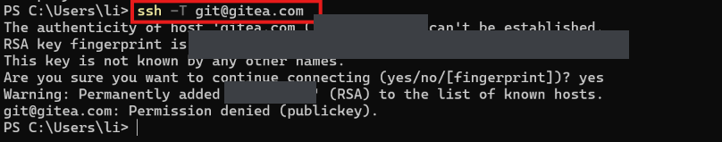
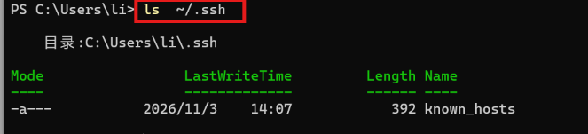
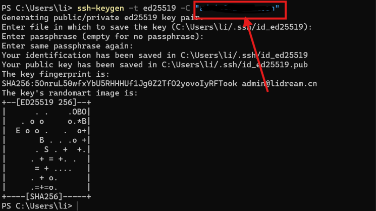
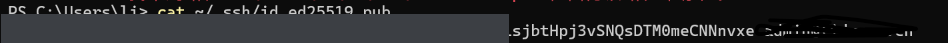
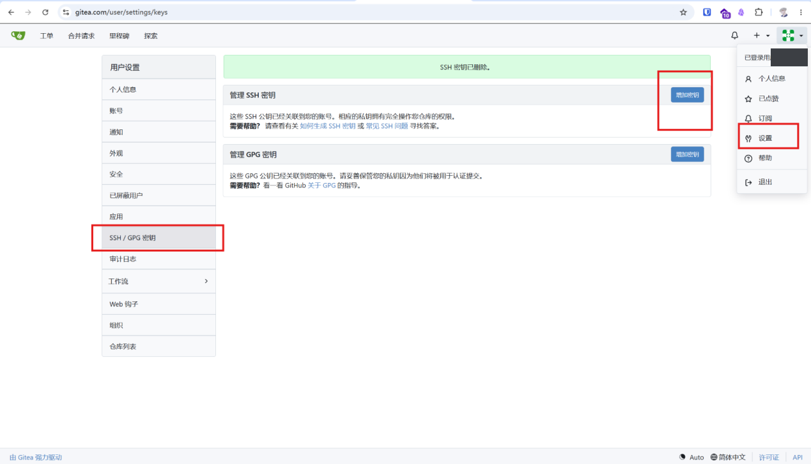
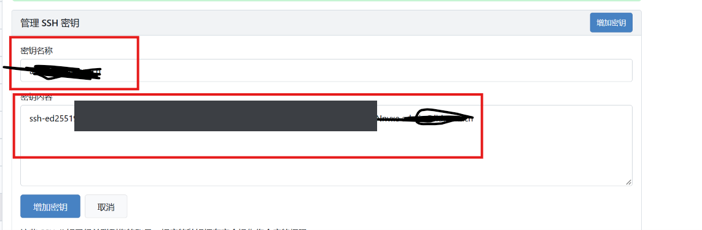
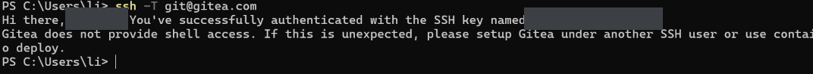

> 自建了 Gitea 之后，最常卡住的就是"怎么让本机 Git 免密连上去"。这篇用一套完整的 Windows 实测流程，把从生成 SSH 密钥到成功推送的每一步都走一遍——每一步都配真实截图。

---

## 目录

1. [先测能不能连上](#一先测能不能连上)
2. [查看本机有没有创建过密钥](#二查看本机有没有创建过密钥)
3. [生成密钥（有的话跳过）](#三生成密钥有的话跳过)
4. [查看公钥](#四查看公钥)
5. [把公钥添加到 Gitea](#五把公钥添加到-gitea)
6. [测试是否成功](#六测试是否成功)
7. [常见坑与排查](#七常见坑与排查)

---

## 一、先测能不能连上

在 PowerShell 里先跑一条命令，看本机跟 Gitea 的 SSH 通道通不通：

```powershell
ssh -T git@gitea.com
```

第一次连会提示确认主机指纹（`RSA key fingerprint`），输入 `yes` 回车即可：



这一步有两个可能结果：

- **`Permission denied (publickey)`** —— 说明 SSH 通道通了，但你还没有可用的密钥对，走下面的流程；
- 直接提示认证成功——说明之前配过，可以跳过生成步骤。

> 注意：这里 `git@gitea.com` 的 `git` 是 Gitea 固定的 SSH 用户名，不是你的账号名。Gitea 通过你上传的公钥来识别你是谁。

---

## 二、查看本机有没有创建过密钥

检查 `~/.ssh` 目录下有没有现成的密钥：

```powershell
ls ~/.ssh
```

如果只有 `known_hosts`（记录着之前连接过的主机指纹），说明还没有生成过密钥对：



`known_hosts` 是连接记录，不是密钥。真正要的是 `id_ed25519`（私钥）和 `id_ed25519.pub`（公钥）这一对文件。

---

## 三、生成密钥（有的话跳过）

没有密钥对就生成一个。推荐 **ed25519** 算法——比 RSA 更短、更快、安全性也足够：

```powershell
ssh-keygen -t ed25519 -C "你的邮箱"
```

一路回车即可（文件路径用默认的 `~/.ssh/id_ed25519`，passphrase 可以留空，也可以设一个增加保护）：



生成完会显示密钥指纹（`SHA256:...`）和一段随机艺术图（randomart），这代表密钥对创建成功。

---

## 四、查看公钥

公钥是 `.pub` 结尾的那个文件，内容是一行 `ssh-ed25519 AAAA...` 开头、以你的邮箱结尾的文本：

```powershell
cat ~/.ssh/id_ed25519.pub
```



**复制这一整行**，下一步要贴到 Gitea 上。注意：私钥（`id_ed25519`，没有 `.pub` 后缀）永远不要发给任何人、也不要贴到网上。

---

## 五、把公钥添加到 Gitea

登录 Gitea，右上角点头像 → **设置（Settings）** → 左侧 **SSH / GPG 密钥** → 在"管理 SSH 密钥"里点**添加密钥**：



把上一步复制的公钥整行粘贴进去，起个名字（比如"我的 Windows 笔记本"），保存：



> 一个公钥对应一台设备。换电脑、换系统都要重新生成并添加，旧设备不用了记得在列表里删掉。

---

## 六、测试是否成功

回到终端，再跑一次最开始那条命令：

```powershell
ssh -T git@gitea.com
```

这次应该看到：

```
Hi there, dydydd! You've successfully authenticated with the SSH key named admin@lidream.cn.
Gitea does not provide shell access. If this is unexpected, please setup Gitea under another SSH user or use container deployment.
```



看到 `successfully authenticated` 就说明密钥配对成功。之后 `git clone`、`git push` 走 SSH 地址（`git@gitea.com:用户名/仓库.git`）就能免密操作了。

> 那句 "Gitea does not provide shell access" 是正常提示，不是报错——Gitea 的 SSH 只用来做 Git 传输，不提供登录 shell。

---

## 七、常见坑与排查

| 现象 | 原因 | 解决 |
|---|---|---|
| `Permission denied (publickey)` | 公钥没上传，或上传的不是当前这台机器的公钥 | 确认 `~/.ssh/id_ed25519.pub` 已添加到 Gitea 账号 |
| 提示 `Host key verification failed` | 主机指纹变了（重装过 Gitea / 换了 IP） | 删掉 `~/.ssh/known_hosts` 里对应行再重连 |
| 用 HTTPS 地址 push 一直要密码 | 走的是 HTTPS 认证而非 SSH | 改用 `git@gitea.com:...` 的 SSH 地址 |
| 换了电脑连不上 | 新机器没有对应私钥 | 在新机器重新生成并添加公钥 |

**一句话总结**：`ssh-keygen` 生成 → `cat ~/.ssh/id_ed25519.pub` 复制 → Gitea 设置里添加 → `ssh -T git@gitea.com` 验证。四步走完，远程仓库就通了。